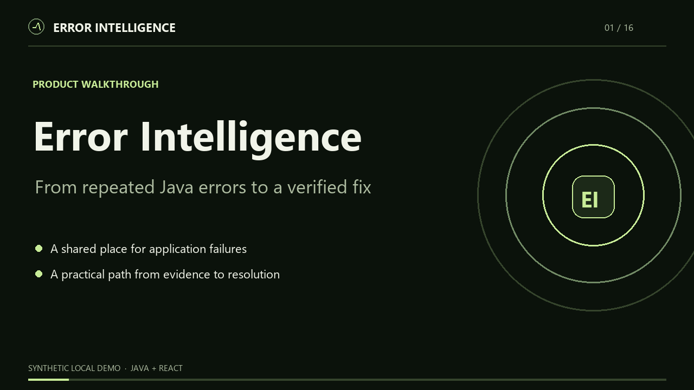

# Error Intelligence

A Java full-stack workspace for application errors, incident investigation and evidence-led diagnostics.



[Watch the narrated product demo](docs/demo/error-intelligence-walkthrough.webm) · [Read the plain-language walkthrough](docs/demo/README.md) · [Start here: user guide](docs/user-guide.md) · [Incident investigation screenshot](docs/screenshots/portfolio-incidents.png) · [Mobile incident screenshot](docs/screenshots/portfolio-mobile-incidents.png) · [Run the no-cost demo](docs/portfolio-demo.md) · [CV and interview evidence](docs/cv-evidence.md)

For an optional public CV demo, use the [free VM deployment guide](docs/cv-deployment.md). It runs the API, database, Redis, frontend, and HTTPS on one small host with paid AI disabled.

## Overview

The product ingests sanitized application failures, groups repeated events and helps engineering teams investigate them with structured AI guidance and verified resolutions. The source blueprint requires a modular monolith, tenant isolation, secure ingestion and measurable production-readiness gates.

**Current delivery: Phase 8 scale decision completed.** Phases 0-6 are complete; Phase 7 has a no-cost, Docker-free local staging rehearsal, while its independent production staging gate remains open. Phase 8's conditional scale-extension gate is complete: [ADR 0004](docs/adr/0004-measured-scale-extension.md) uses fresh local load evidence to defer Kafka, batch analytics, and partitioning until a measured bottleneck warrants them. See [Phase 8 verification](docs/phase-8-verification.md), [Phase 7 verification](docs/phase-7-verification.md), and the [local rehearsal guide](docs/phase-7-local-rehearsal.md).

Phase 1 and 2 design and native test evidence are in [phase-1-verification.md](docs/phase-1-verification.md) and [phase-2-verification.md](docs/phase-2-verification.md). Phase 4 behavior and test evidence are in [phase-4-design.md](docs/phase-4-design.md) and [phase-4-verification.md](docs/phase-4-verification.md). Phase 5 design and verification are in [phase-5-design.md](docs/phase-5-design.md) and [phase-5-verification.md](docs/phase-5-verification.md).

## Problem statement

Raw stack traces and isolated API failures make recurring issues hard to track. The completed platform will connect errors to projects, environments and releases, retain investigation history, and make verified knowledge reusable.

## Features

Implemented: live service readiness, email-verified registration, password recovery, login, BCrypt passwords, short-lived JWT access, rotating hashed refresh sessions, CSRF protection, organization roles, tenant-scoped projects, hashed/revocable ingestion keys, bounded/redacted idempotent event intake, deterministic incident grouping, incident status/assignment, comments and human-verified resolutions.

Implemented: secure event ingestion, versioned incident grouping, investigation workflows, Phase 4 diagnostic queue/API/UI, Phase 5 semantic retrieval with verified-resolution context, and Phase 6 tenant-scoped analytics, admin audit review, bounded raw-event retention, Prometheus metrics, and opt-in OTLP traces. Phase 7 local hardening is rehearsed; Phase 8's scale decision retains the modular monolith pending representative evidence.

## Technology stack

Java 21; Spring Boot 3.5.16; MVC/Security/Validation; JPA/Hibernate; PostgreSQL with pgvector; Flyway; Redis; React/TypeScript/Vite; TanStack Query; JUnit 5/Mockito/MockMvc/Testcontainers; Vitest/RTL; Playwright. The OpenAI adapters use bounded server-side requests and structured diagnostic output. Provider calls are disabled in the no-cost local staging demo.

## Architecture

React -> same-origin REST proxy -> controller/DTO -> module service -> scoped repository -> PostgreSQL. Redis backs distributed authentication rate limits outside the loopback-only native profile. See [architecture](docs/architecture.md) and [ADRs](docs/adr).

## Project structure

```text
error-intelligence-platform/
|-- front-end/   React/TypeScript app, browser tests and demo capture
|-- back-end/    Java API, Flyway migrations and PostgreSQL tests
|-- docs/        Shared architecture, API, operations and audit evidence
|-- scripts/     Project-level local setup and verification commands
|-- infra/       Optional deployment and observability configuration
`-- .github/     CI workflow
```

The two application folders have their own [front-end guide](front-end/README.md) and [back-end guide](back-end/README.md). Shared documentation and tools stay at the repository root. Local credentials and service data stay in ignored `.env` and `.local` paths.

## Database

Database V1 creates the intelligence schema; V2 adds identity, tenancy, audit and project foundations; V3 adds secure event persistence. Flyway history is stored in public. Hibernate validates migrations and never creates production tables.


## API documentation

See [API overview](docs/api.md) and [OpenAPI](docs/openapi.yaml). Public routes include health, system metadata, CSRF token retrieval, registration, email verification, password recovery and login. Protected resources require a live JWT session and organization membership.

## Authentication

Passwords use BCrypt. New accounts must verify their email before sign-in. Verification and password reset links expire after 30 and 15 minutes respectively, work once, and are stored only as digests. Resetting a password revokes active sessions. Access tokens stay in browser memory; rotating refresh credentials are hashed at rest and sent in a Secure, HttpOnly, SameSite cookie outside native development. Unsafe browser requests require CSRF protection. Tenant scope comes from the authenticated session, and unknown tenant resources return 404. See [identity design](docs/phase-1-design.md).

## Installation

Required for host development: Java 21, Node 22.12 or newer on the 22 release line, and PostgreSQL. Maven is supplied by the official wrapper. Docker is optional for local development and required only for the container/Testcontainers path. The loopback-only `native` profile uses bounded single-process login limits; production uses Redis-backed distributed limits and fails closed when Redis is unavailable.

On this workspace a portable Java 21/Maven toolchain is available in ignored .tools. It is not committed or required for other machines. The native development profile and local staging demo leave AI workers off by default, so opening the demo does not make paid model calls.

Initialize ignored local configuration:

```powershell
node scripts/initialize-local.mjs
```

The helper creates random database/cache passwords, never prints them and preserves any existing .env. On Windows, run scripts/Local-Database.ps1 to initialize an isolated cluster under .local using your installed PostgreSQL binaries. It stages the project-local pgvector runtime from ignored `.tools/pgvector-runtime` and restarts only that isolated cluster if an older start did not expose the extension. Its default port is 15432, separate from an existing service on 5432. Set PG_BIN if PostgreSQL is installed elsewhere. On other platforms, use a dedicated PostgreSQL database/user with pgvector configured to match .env. Do not modify another project's database.

## Environment variables

| Variable | Purpose |
| --- | --- |
| DB_URL | PostgreSQL JDBC URL for host backend |
| DB_USERNAME / DB_PASSWORD | Dedicated database user credentials |
| REDIS_HOST / REDIS_PORT / REDIS_PASSWORD | Cache connection |
| SERVER_PORT | Host backend port; default 8080 |
| FRONTEND_PORT | Frontend port; default 5173 |
| PUBLIC_APP_URL | Browser origin used in email links; HTTPS is required outside native development |
| SMTP_HOST / SMTP_PORT / SMTP_USERNAME / SMTP_PASSWORD | Mail server for hosted verification and password reset emails |
| SMTP_AUTH / SMTP_STARTTLS / MAIL_FROM | SMTP authentication, TLS, and sender address |
| API_PROXY_TARGET | Vite development proxy target; default local backend |
| POSTGRES_DB / POSTGRES_USER / POSTGRES_PASSWORD / POSTGRES_PORT | Optional Compose database settings |
| DB_POOL_SIZE | Maximum backend database connections; default 10 |
| SPRING_PROFILES_ACTIVE | native for loopback Docker-free development; omit to require production Redis |
| PG_BIN | PostgreSQL binaries for isolated Windows development and native integration tests |
| RAW_EVENT_RETENTION_DAYS | Raw event retention window; `0` disables deletion (default) |
| RAW_EVENT_RETENTION_INTERVAL | Retention job interval; default `PT1M`, drains bounded batches within a five-second budget |
| PROMETHEUS_ALLOWED_CIDRS | Networks allowed to scrape metrics; defaults to loopback only |
| OTEL_TRACING_ENABLED | Set `true` to enable OTLP tracing export |
| OTEL_EXPORTER_OTLP_TRACES_ENDPOINT | OTLP HTTP traces endpoint; default local collector URL |

Raw-event retention is off by default (`RAW_EVENT_RETENTION_DAYS=0`). If enabled, the job runs each minute and deletes up to twenty 500-row batches within a five-second budget after removing their occurrence/fingerprint references; incident counts, groups, comments, resolutions, embeddings and AI records remain. Select a retention period only after defining the product's data-retention policy. Prometheus scraping defaults to loopback CIDRs; add only the private scraper network to `PROMETHEUS_ALLOWED_CIDRS`. OTLP export needs a reachable collector and remains disabled until `OTEL_TRACING_ENABLED=true`.

Root .env is loaded by the Windows backend runner and Docker Compose. Spring Boot does not automatically read .env when launched directly; export variables into the process environment on other platforms. No secret belongs in a VITE_ variable or committed frontend file.

The `native` profile writes development verification and recovery emails to ignored `.local/mail/*.txt`; open the latest file addressed to your test email and follow its link. A hosted deployment uses SMTP and must configure `PUBLIC_APP_URL` to its HTTPS frontend origin, `SMTP_HOST`, and `MAIL_FROM` (plus provider credentials). Account mail is queued in an encrypted database outbox and retried after delivery failures. Existing accounts are marked verified by migration V11 so they remain usable.

## Running locally

Start the isolated database and backend from the root:

```powershell
powershell -File scripts/Local-Database.ps1
powershell -File scripts/Run-Backend.ps1
```

Start the frontend in a second terminal:

```powershell
cd front-end
npm ci
npm run dev
```

Open http://127.0.0.1:5173. Refresh checks show backend-reported state. An unavailable dependency is shown explicitly. The UI labels Redis as deferred in native mode. Stop only this project's database with powershell -File scripts/Local-Database.ps1 -Action Stop.

Optional full-container **local test** path (verification emails appear in `.local/mail`):

```powershell
New-Item -ItemType Directory -Force .local/mail | Out-Null
docker compose -f infra/compose.yml -f infra/compose.ci.yml --env-file .env --profile app up --build -d --wait
```

The file-mail override is only for loopback development and CI. The [public CV deployment](docs/cv-deployment.md) uses HTTPS and SMTP. Infrastructure only: omit `--profile app`, then run Java/React on the host.

## Testing

```powershell
# Format and run unit tests without Docker
powershell -File scripts/Run-Backend.ps1 -Action Format
powershell -File scripts/Run-Backend.ps1 -Action Unit

# Full backend gate: requires Docker for PostgreSQL/Redis Testcontainers
powershell -File scripts/Run-Backend.ps1 -Action Verify

# Docker-free gate: installed PostgreSQL, isolated throwaway clusters
powershell -File scripts/Run-Backend.ps1 -Action VerifyNative

cd front-end
npm run format:check
npm run lint
npm test
npm run build
npx playwright install chromium
npm run test:e2e
```

Both backend gates share migration, identity, ingestion, incident, and foundation HTTP contracts against real PostgreSQL. Backup/restore and the HTTP load gate are native-specific; container identity additionally exercises Redis-backed limits. Native tests additionally stop their isolated database to verify readiness failure and liveness recovery. Native tests do not assert Redis connectivity. The default gate retains PostgreSQL/Redis Testcontainers and fails if Docker is unavailable; no tests are silently skipped. Browser smoke tests run desktop/mobile layouts; set E2E_REQUIRE_READY=true when validating a running backend.

## Screenshots

The current [portfolio screenshots](docs/portfolio-demo.md) come from the live local app with clearly labeled synthetic data. No sample analytics are presented as customer results. Earlier foundation screenshots remain in `docs/screenshots` for build history.

## Deployment

Non-root back-end/front-end Dockerfiles and local Compose are supplied for environments that choose them. The Phase 7 local checks and the staging path in [the staging checklist](docs/phase-7-staging-checklist.md) do not use Docker Desktop. A Java 21 JAR can run as a restricted service behind an HTTPS reverse proxy, with PostgreSQL and Redis on separate private services.

Production requires TLS, private managed PostgreSQL/Redis, secrets management, immutable artifact digests, automated backups, restore verification and reviewed backward-compatible migrations. The no-cost local rehearsal verifies the rollout and rollback mechanism on one computer; an independent host remains future deployment work. See the [runbook](docs/runbook.md).

CI defines backend format/build/unit/integration checks, frontend format/lint/test/build/audit checks and a complete container/browser smoke test. Remote CI status can be established after this repository is pushed; no GitHub repository has been created or pushed yet.

## Future improvements

For a later production deployment, complete the independent [staging acceptance checklist](docs/phase-7-staging-checklist.md): review dependency advisories, verify public HTTPS and secret injection, off-machine encrypted backups, alert delivery, and capacity under representative traffic. Revisit Kafka, batch analytics, or partitioning only after the measured triggers in [ADR 0004](docs/adr/0004-measured-scale-extension.md).

## Repository status

The source, synthetic screenshots, and verification notes are prepared for a portfolio repository. `.env`, `.local`, `.tools`, build artifacts, and dependency folders are ignored. No GitHub remote or public deployment is configured; remote CI and a production staging environment remain unverified.

## Author

Shrawan Gautam. Add your preferred public profile/CV link when publishing.

Current hardening implementation and verification: [13 October improvements](docs/improvement-implementation-2026-10-13.md). New migrations V8-V10 add worker claims, embedding budgets, and retention-safe receipts. Run the live native browser gate with Maven `verify -Pnative-postgres -Dit.test=NativeBrowserIT` and installed Chromium; see the implementation notes for required local paths.

The follow-up local hardening and release-security assessment is recorded in [18 October review completion](docs/review-completion-2026-10-18.md). See [release readiness](docs/release-readiness.md) for the remaining release gates.
