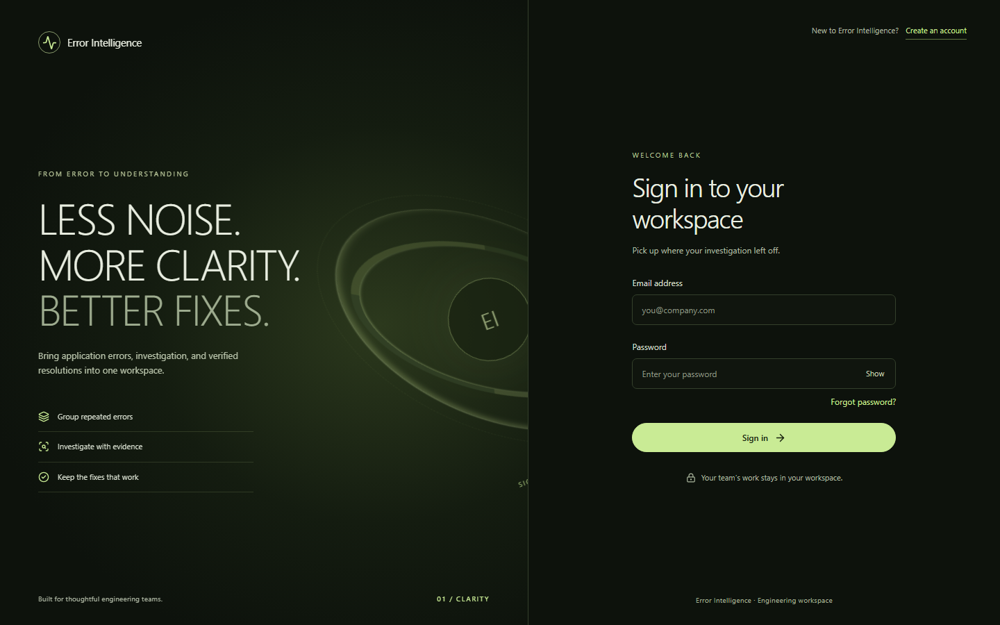
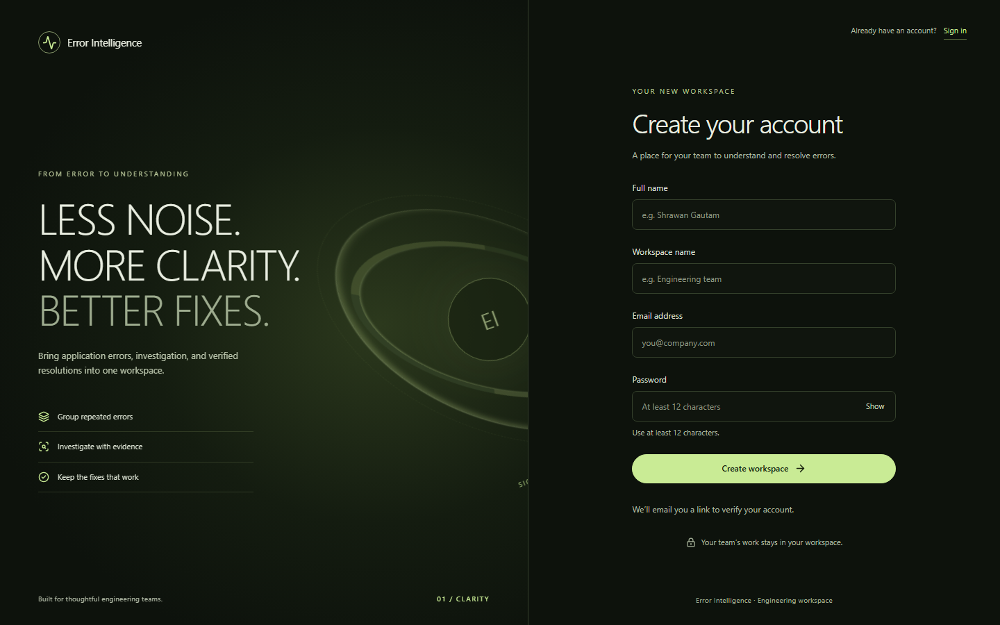
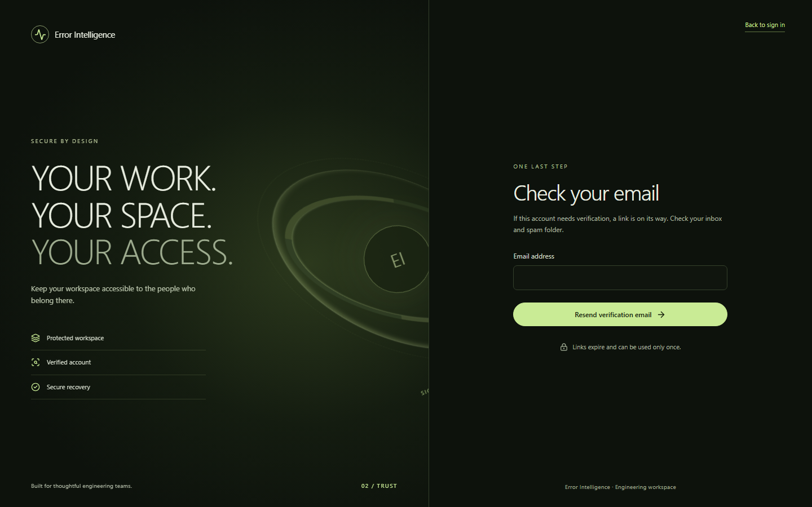
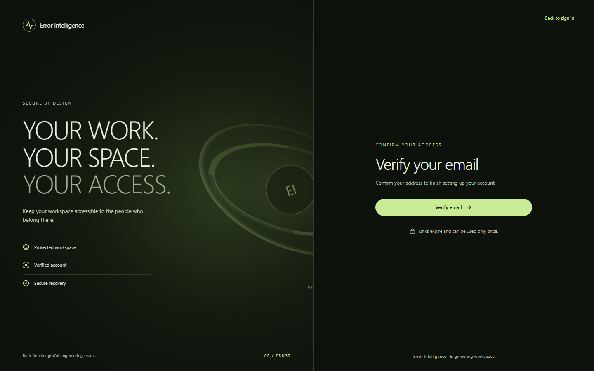
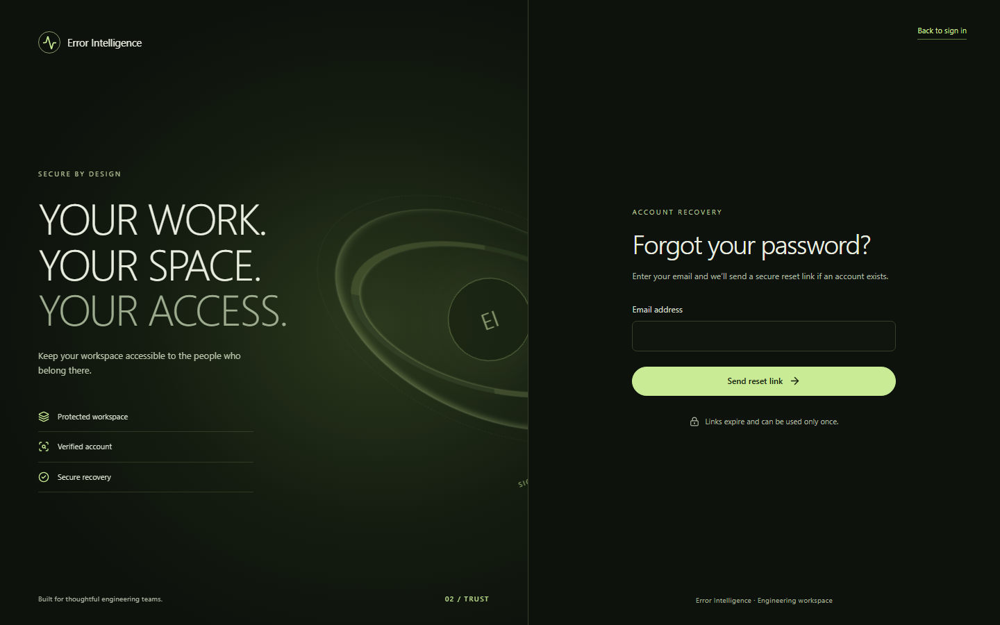
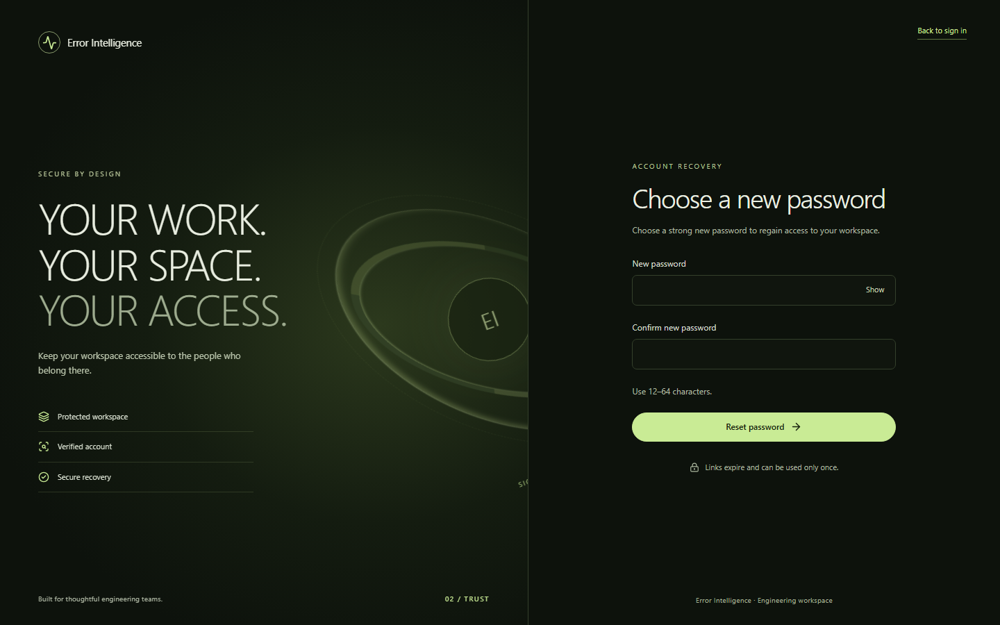
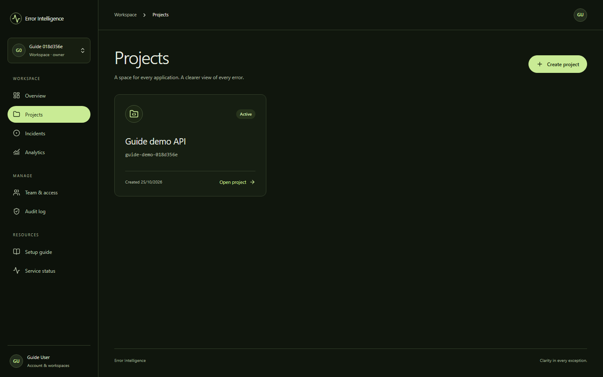
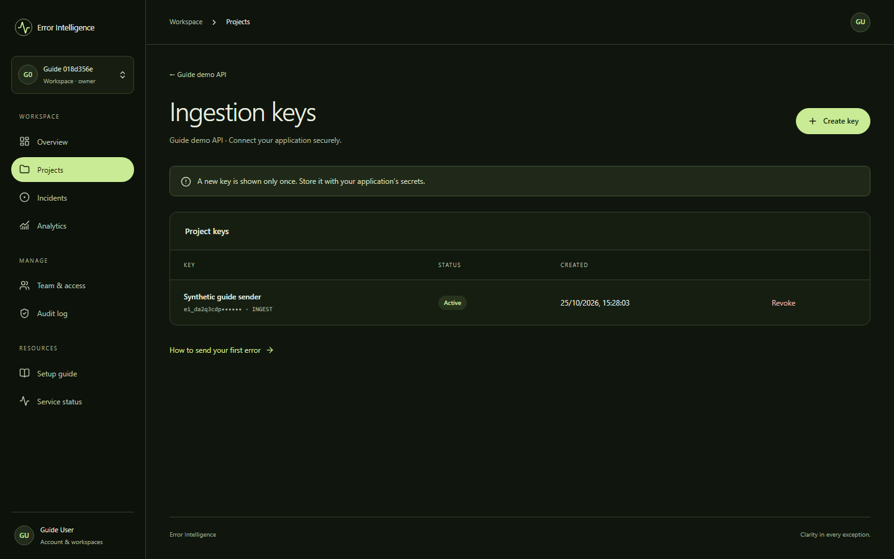
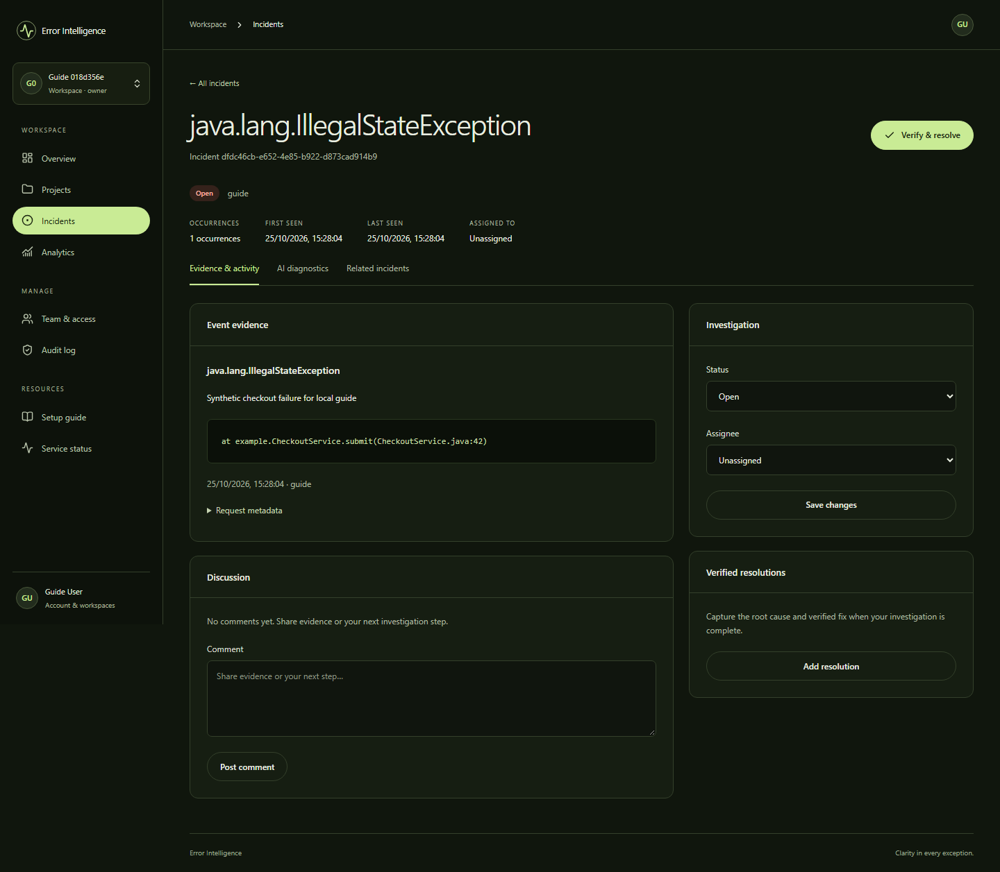
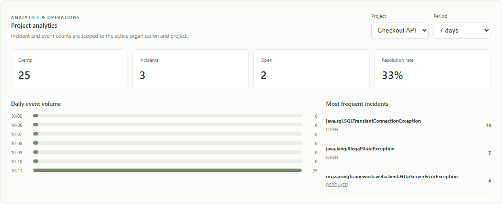

# Error Intelligence — local user guide

[Watch the narrated product walkthrough](demo/error-intelligence-walkthrough.webm) for the problem, the end-to-end flow, and the main screens before following the steps below.

This guide shows how an engineer uses the running product from an empty workspace to a visible incident. The screenshots come from the real browser connected to the project's **isolated, synthetic local staging database**. They contain no real customer errors or plaintext keys. The normal local development URLs are used in the steps below.

## 1. Confirm the frontend is connected

From the repository root in VS Code PowerShell, run the project database and backend in one terminal:

```powershell
powershell.exe -NoProfile -ExecutionPolicy Bypass -File scripts\Local-Database.ps1 -Action Start
powershell.exe -NoProfile -ExecutionPolicy Bypass -File scripts\Run-Backend.ps1
```

In a second terminal:

```powershell
cd front-end
npm run dev
```

Open <http://127.0.0.1:5173/login>. Sign-in and account creation are separate pages. Once signed in, open **Service status** from the left navigation; it should say **Services connected**. The frontend proxies `/api` and `/actuator` calls to the Java backend at `http://127.0.0.1:8080`; the backend stores application data in the project's isolated PostgreSQL database. Verify the same path yourself:

```powershell
Invoke-RestMethod http://127.0.0.1:5173/actuator/health/readiness
Invoke-RestMethod http://127.0.0.1:5173/api/v1/system
```

The first response should have `status` equal to `UP`. A connected UI can still look empty until a user creates a project and sends an event. No Docker Desktop container or company project is involved in this local path.



## 2. Create your workspace account

On the sign-in page, select **Create an account** to open `/register`. Enter your name, a workspace name, email address, and a password of at least 12 characters. Select **Create workspace**. The app opens **Check your email**. In local development, the Java backend writes a verification email to the ignored `./.local/mail` folder at the repository root. Open the newest `.txt` file addressed to your email, follow its `verify-email` link, select **Verify email**, and then sign in at `/login`. The link expires after 30 minutes and works once. Hosted installations deliver this email through SMTP.







**What happens behind the UI:** the React form calls the Java authentication API. The backend creates the account and organization in PostgreSQL, queues the verification email, and allows a session only after email confirmation. This is a product account, separate from your OpenAI Platform account.

If you forget your password, select **Forgot password?** on `/login`, enter the account email, and use the link from your inbox or local `.local/mail` folder. Set a new password and sign in again. The reset link expires after 15 minutes, works once, and revokes existing sessions. The page gives the same confirmation for known and unknown email addresses.





## 3. Create a project

In **Projects**, select **Create project**. Enter a project name, such as `My Java API`, and a lowercase URL slug, such as `my-java-api`. Select **Create project** in the dialog. The project scopes its events, incidents, analytics, and ingestion keys. If you already see a project, you can use it.



## 4. Create an ingestion key for that project

Open the project, then select **Ingestion keys**. Select **Create key**, enter a label such as `Local demo sender`, and confirm. Copy the new `ei_...` value immediately: it is displayed only once. Keep it server-side or in your local secret manager. If you lose it, revoke that key and create another. The screenshot shows only the safe prefix of an existing key.



**Use this project ingestion key for the next step.** It is *not* the OpenAI API key. An OpenAI key is relevant only if you later enable paid AI diagnosis or semantic retrieval. Basic account, project, ingestion, incident, and analytics flows work without paid AI.

## 5. Send a first test error to the backend

An application sends error events to `POST /ingest/v1/events`; the UI does not invent them automatically. With the backend still running, paste the following into a **new PowerShell terminal** from anywhere. When prompted, paste the project ingestion key you just copied. PowerShell will not display it as you type. The command uses invented test data and never prints the key.

```powershell
$secureKey = Read-Host 'Paste project ingestion key (ei_...)' -AsSecureString
$key = [System.Net.NetworkCredential]::new('', $secureKey).Password
$event = @{
  eventId = [guid]::NewGuid().ToString()
  occurredAt = [DateTimeOffset]::UtcNow.ToString('o')
  environment = 'local-demo'
  exceptionType = 'java.lang.IllegalStateException'
  message = 'Synthetic checkout failure for local demo'
  stackTrace = 'at example.CheckoutService.submit(CheckoutService.java:42)'
} | ConvertTo-Json
try {
  Invoke-RestMethod -Method Post -Uri 'http://127.0.0.1:8080/ingest/v1/events' `
    -Headers @{ 'X-API-Key' = $key } -ContentType 'application/json' -Body $event
} finally {
  $key = $null
  $secureKey = $null
}
```

A successful request returns an event receipt with HTTP **202 Accepted**. The backend authenticates the project key, sanitizes and saves the event, then groups it into an incident. Run the command again to add another occurrence; each run generates a new event UUID. Do not send passwords, tokens, personal data, or real production stack traces while learning the workflow.

## 6. Investigate and resolve the incident

Return to the browser and open **Incidents** from the left navigation. Select your project and set the status filter to **All statuses** if needed. Select the new incident to view **Evidence & activity**. A developer or owner can change status, assign a member, add a comment, and enter a resolution summary and root cause before selecting **Verify & resolve**. Repeated events with the same fingerprint are grouped together.



The **Analyze incident** and **Find similar incidents** buttons belong to the optional AI workflow. In the free local demo, background AI workers are disabled, so these buttons do not demonstrate a completed AI diagnosis. The incident investigation and manual resolution flow is still usable.

## 7. Review analytics

Open **Analytics**, choose the same project and a time period. You will see event totals, incident counts, open incidents, resolution rate, daily volume, and frequent incidents. The screenshot below uses 25 synthetic events already ingested in local staging; your new workspace starts with smaller numbers.



## What is still needed for everyday use

The backend and UI are connected, but a separate application must actually **send its errors**. The PowerShell command above proves the full path; for ongoing use, add a small server-side sender to your Java app or another service that posts sanitized failures with its project ingestion key. The current UI does not capture errors automatically from VS Code or from your browser.

The free local profile does not run paid AI workers, so completed AI diagnoses are not part of this demo. Public hosting and the independent production staging gate are also still open. You can use registration, projects, ingestion, incident investigation, manual verified resolutions, and analytics locally now.

## If something does not appear

| Symptom | Check |
| --- | --- |
| **Connection unavailable** | Check that the Java backend is still running. Run `Invoke-RestMethod http://127.0.0.1:8080/actuator/health/readiness`; then check the Vite terminal and `http://127.0.0.1:5173`. |
| **No projects** | Sign in, then use **Create project**. Projects are scoped to the active workspace. |
| **Verification or reset email missing** | In native development, check the newest `.txt` addressed to you in `.local/mail` under the repository root. Ensure the backend remains running. On a hosted environment, check SMTP configuration and delivery logs. |
| **No incidents** | Create a project ingestion key, send the test event above, refresh, choose that project, and use **All statuses**. Merely creating a project does not create an incident. |
| **401 or 403 while ingesting** | Use the `ei_...` project ingestion key, not the OpenAI key or your login password. Check that the key is active and belongs to the intended project. |
| **No AI result** | The no-cost local profile keeps AI workers disabled. Manual investigation and analytics remain available. |

For the API contract, see [API overview](api.md). For a ready-made 25-event synthetic demo, see [Portfolio demo](portfolio-demo.md). For setup details, see the [repository README](../README.md). The project is locally rehearsed; it has not completed the separate public/production staging gate.
